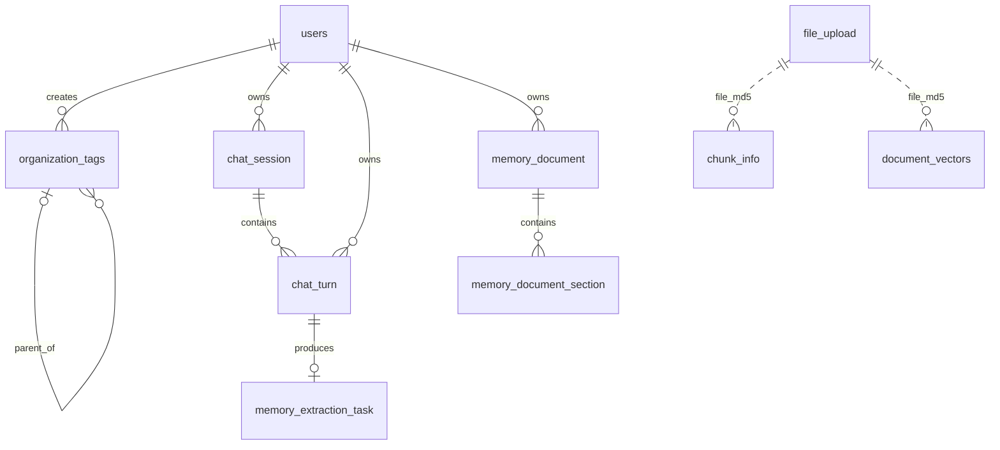

# yeRAG 数据库表设计

本文档描述 yeRAG 当前完整的 MySQL 8.0 关系模型。空数据库初始化脚本是 [ddl.sql](ddl.sql)，包含用户、组织、文件、文档和统一记忆链路的 10 张表。

## 1. 存储边界

| 存储 | 职责 |
| --- | --- |
| MySQL | 用户、组织、文件元数据、解析文本、会话回合、提取任务和长期记忆文档的权威数据源 |
| Redis | 登录令牌、限流、上传状态以及 memory 短期上下文缓存，不是长期记忆权威来源 |
| Elasticsearch | RAG 文档检索索引，不保存个人长期记忆 |
| MinIO | 原始文件和上传分片对象 |
| Kafka | 文件解析与向量化任务传递，不承担持久业务状态 |

`ddl.sql` 只创建 MySQL 对象。Redis、Elasticsearch、MinIO 和 Kafka 需要分别初始化。

## 2. 表清单

| 领域 | 表 | 说明 |
| --- | --- | --- |
| 身份与组织 | `users` | 用户账号、角色和组织归属 |
| 身份与组织 | `organization_tags` | 可形成树形关系的组织标签 |
| 文件与知识库 | `file_upload` | 用户文件及访问范围 |
| 文件与知识库 | `chunk_info` | 分片上传期间的 MinIO 对象元数据 |
| 文件与知识库 | `document_vectors` | 解析后的文本块及检索权限元数据 |
| Memory | `chat_session` | 业务会话与滚动摘要 |
| Memory | `chat_turn` | 可恢复、可过期的完整问答回合 |
| Memory | `memory_extraction_task` | 长期记忆异步提取队列 |
| Memory | `memory_document` | 用户当前 Markdown 长期记忆正文 |
| Memory | `memory_document_section` | Markdown section 的稳定身份和顺序屏障 |

## 3. 关系总览



实线表示数据库外键；虚线表示应用层逻辑关联。文件相关表使用 `file_md5` 和字符串形式的 `user_id` 兼容上传与知识库链路，因此没有指向 `users.id` 的数据库外键。

## 4. 身份与组织

### 4.1 `users`

用户与 memory 所有权的根表。

| 字段 | 类型 | 可空/默认 | 约束与说明 |
| --- | --- | --- | --- |
| `id` | `BIGINT` | 非空，自增 | 主键 |
| `username` | `VARCHAR(255)` | 非空 | 唯一登录名，`uk_users_username` |
| `password` | `VARCHAR(255)` | 非空 | 编码后的密码，不存明文 |
| `role` | `ENUM('USER','ADMIN')` | 默认 `USER` | 应用角色 |
| `org_tags` | `VARCHAR(255)` | 可空 | 逗号分隔的组织标签集合 |
| `primary_org` | `VARCHAR(255)` | 可空 | 主组织标签 |
| `created_at` | `DATETIME(6)` | 当前时间 | 创建时间 |
| `updated_at` | `DATETIME(6)` | 当前时间，自动更新 | 最后修改时间 |

删除用户前必须显式处理其组织、会话和 memory 数据；DDL 不配置级联删除，避免误删审计链和长期记忆。

### 4.2 `organization_tags`

组织标签采用邻接表表达层级。

| 字段 | 类型 | 可空/默认 | 约束与说明 |
| --- | --- | --- | --- |
| `tag_id` | `VARCHAR(255)` | 非空 | 主键，业务标签 ID |
| `name` | `VARCHAR(255)` | 非空 | 展示名称 |
| `description` | `TEXT` | 可空 | 描述 |
| `parent_tag` | `VARCHAR(255)` | 可空 | 自关联父标签；父标签删除时置空 |
| `created_by` | `BIGINT` | 非空 | 外键到 `users.id` |
| `created_at` | `DATETIME(6)` | 当前时间 | 创建时间 |
| `updated_at` | `DATETIME(6)` | 当前时间，自动更新 | 最后修改时间 |

索引 `ix_organization_tags_parent` 支持向下查找子组织，`ix_organization_tags_creator` 支持按创建者查询。

## 5. 文件与知识库

### 5.1 `file_upload`

保存完整文件的业务元数据。实际文件内容存放在 MinIO。

| 字段 | 类型 | 可空/默认 | 约束与说明 |
| --- | --- | --- | --- |
| `id` | `BIGINT` | 非空，自增 | 主键 |
| `file_md5` | `VARCHAR(32)` | 非空 | 完整文件 MD5 |
| `file_name` | `VARCHAR(255)` | 非空 | 原始文件名 |
| `total_size` | `BIGINT` | 非空 | 文件字节数 |
| `status` | `TINYINT` | 默认 `0` | `0` 上传中，`1` 已完成 |
| `user_id` | `VARCHAR(64)` | 非空 | 上传链路中的认证用户标识 |
| `org_tag` | `VARCHAR(255)` | 可空 | 所属组织标签 |
| `is_public` | `TINYINT(1)` | 默认 `0` | 是否公开 |
| `created_at` | `DATETIME(6)` | 当前时间 | 创建时间 |
| `merged_at` | `DATETIME(6)` | 可空 | 分片合并完成时间 |

同一用户不能重复创建同一 `file_md5`，由 `uk_file_upload_md5_user` 保证。用户、组织和公开性均有查询索引。

### 5.2 `chunk_info`

记录上传阶段的物理文件分片。分片合并后可以按业务清理，不能把它当作文档语义切块。

| 字段 | 类型 | 可空/默认 | 约束与说明 |
| --- | --- | --- | --- |
| `id` | `BIGINT` | 非空，自增 | 主键 |
| `file_md5` | `VARCHAR(32)` | 非空 | 完整文件 MD5 |
| `chunk_index` | `INT` | 非空 | 上传分片顺序，从 0 开始 |
| `chunk_md5` | `VARCHAR(32)` | 非空 | 单个分片 MD5 |
| `storage_path` | `VARCHAR(255)` | 非空 | MinIO 对象路径 |

`ix_chunk_info_file_order(file_md5, chunk_index)` 支持按顺序合并文件。

### 5.3 `document_vectors`

保存解析后的语义文本块和访问控制元数据。在线向量检索索引位于 Elasticsearch；该表名称沿用项目现有模型。

| 字段 | 类型 | 可空/默认 | 约束与说明 |
| --- | --- | --- | --- |
| `vector_id` | `BIGINT` | 非空，自增 | 主键 |
| `file_md5` | `VARCHAR(32)` | 非空 | 来源文件 MD5 |
| `chunk_id` | `INT` | 非空 | 文本块顺序 |
| `text_content` | `LONGTEXT` | 可空 | 解析后的文本 |
| `model_version` | `VARCHAR(32)` | 可空 | Embedding 模型版本 |
| `user_id` | `VARCHAR(64)` | 非空 | 上传者标识 |
| `org_tag` | `VARCHAR(50)` | 可空 | 权限组织标签 |
| `is_public` | `TINYINT(1)` | 默认 `0` | 是否公开 |

`file_md5` 用于整文件重建或删除；`user_id`、`org_tag`、`is_public` 用于 RAG 检索前的访问范围过滤。

## 6. Memory

Memory 只保存两类长期记忆：

| `memory_type` | 生成文件 | 内容 |
| --- | --- | --- |
| `PROFILE` | `profile.md` | 用户稳定背景、角色、技能和知识水平 |
| `PREFERENCE` | `preferences.md` | 用户稳定的回答、格式和交互偏好 |

运行时的 `MEMORY.md` 是召回索引，由当前有效 section 确定性生成，不单独落库。

### 6.1 `chat_session`

| 字段 | 类型 | 可空/默认 | 约束与说明 |
| --- | --- | --- | --- |
| `id` | `CHAR(36)` | 非空 | UUID 主键 |
| `user_id` | `BIGINT` | 非空 | 外键到 `users.id` |
| `status` | `VARCHAR(20)` | 非空 | `OPEN`、`CLOSED` |
| `last_activity_at` | `DATETIME(6)` | 非空 | 最近一次被接受的活动时间 |
| `context_expires_at` | `DATETIME(6)` | 非空 | 短期上下文失效时间 |
| `created_at` | `DATETIME(6)` | 非空 | 创建时间 |
| `closed_at` | `DATETIME(6)` | 可空 | 关闭时间 |
| `revision` | `BIGINT` | 默认 `0` | 会话状态版本 |
| `context_summary` | `TEXT` | 可空 | MySQL 持久化的滚动摘要 |
| `summary_covered_turn_seq` | `BIGINT` | 默认 `0` | 已纳入摘要的最后回合 ID |
| `summary_revision` | `BIGINT` | 默认 `0` | 摘要条件更新版本 |
| `active_turn_id` | `BIGINT` | 可空 | 当前执行中的回合 ID |

`active_turn_id` 不设置循环外键：`chat_turn` 本身已经引用 `chat_session`，当前回合一致性由锁定 `users.id` 的事务维护。一个用户同时只应有一个可写的 `OPEN` 会话。

### 6.2 `chat_turn`

| 字段 | 类型 | 可空/默认 | 约束与说明 |
| --- | --- | --- | --- |
| `id` | `BIGINT` | 非空，自增 | 主键 |
| `session_id` | `CHAR(36)` | 非空 | 外键到 `chat_session.id` |
| `user_id` | `BIGINT` | 非空 | 外键到 `users.id`，便于所有权校验和按用户排序 |
| `user_turn_seq` | `BIGINT` | 可空 | 创建后写入回合 ID，作为用户级顺序屏障 |
| `request_id` | `VARCHAR(80)` | 非空 | 客户端幂等键 |
| `request_hash` | `CHAR(64)` | 非空 | 原始问题的 SHA-256 |
| `question` | `MEDIUMTEXT` | 可空 | 原始问题，超过保留期后清空 |
| `answer` | `MEDIUMTEXT` | 可空 | 完整回答，超过保留期后清空 |
| `status` | `VARCHAR(20)` | 非空 | `RUNNING`、`COMPLETED`、`CANCELLED`、`FAILED` |
| `context_sync_status` | `VARCHAR(20)` | 默认 `NONE` | `NONE`、`PENDING`、`SYNCED`、`EXPIRED` |
| `context_sync_attempts` | `INT` | 默认 `0` | 短期上下文同步尝试次数 |
| `context_next_attempt_at` | `DATETIME(6)` | 可空 | 下次同步时间 |
| `created_at` | `DATETIME(6)` | 非空 | 创建时间 |
| `completed_at` | `DATETIME(6)` | 可空 | 完成时间 |
| `content_expires_at` | `DATETIME(6)` | 非空 | 问答正文清理期限 |

关键约束：

- `(user_id, request_id)` 唯一，保证客户端重试幂等。
- `(user_id, user_turn_seq)` 唯一，保证用户回合顺序。
- `request_id` 重用时必须同时匹配 `request_hash` 和目标会话。
- 完成回合后才创建长期记忆提取任务。

### 6.3 `memory_extraction_task`

| 字段 | 类型 | 可空/默认 | 约束与说明 |
| --- | --- | --- | --- |
| `id` | `BIGINT` | 非空，自增 | 主键 |
| `turn_id` | `BIGINT` | 非空、唯一 | 外键到来源 `chat_turn.id` |
| `status` | `VARCHAR(20)` | 非空 | `PENDING`、`RUNNING`、`DONE`、`FAILED`、`EXPIRED` |
| `attempts` | `INT` | 默认 `0` | 领取次数 |
| `next_attempt_at` | `DATETIME(6)` | 非空 | 最早可再次领取时间 |
| `lease_until` | `DATETIME(6)` | 可空 | worker 租约到期时间 |
| `lease_token` | `CHAR(36)` | 可空 | 当前 worker 的 UUID token |
| `last_error_code` | `VARCHAR(80)` | 可空 | 最后一次受限错误码 |
| `created_at` | `DATETIME(6)` | 非空 | 创建时间 |
| `updated_at` | `DATETIME(6)` | 非空 | 更新时间 |

一个完成回合最多对应一个提取任务。worker 使用 `FOR UPDATE SKIP LOCKED` 领取任务；同一用户必须按 `user_turn_seq` 顺序处理，不同用户可以并行。提交时必须再次校验任务状态、租约 token、租约期限和来源回合。

### 6.4 `memory_document`

| 字段 | 类型 | 可空/默认 | 约束与说明 |
| --- | --- | --- | --- |
| `id` | `BIGINT` | 非空，自增 | 主键 |
| `user_id` | `BIGINT` | 非空 | 外键到 `users.id` |
| `memory_type` | `VARCHAR(20)` | 非空 | `PROFILE` 或 `PREFERENCE` |
| `content` | `MEDIUMTEXT` | 非空 | 完整 Markdown 正文 |
| `created_at` | `DATETIME(6)` | 非空 | 创建时间 |
| `updated_at` | `DATETIME(6)` | 非空 | 正文最后更新时间 |

`(user_id, memory_type)` 唯一，因此每个用户最多拥有一份 profile 和一份 preferences 文档。空提取结果不会创建空文档。

### 6.5 `memory_document_section`

| 字段 | 类型 | 可空/默认 | 约束与说明 |
| --- | --- | --- | --- |
| `id` | `CHAR(36)` | 非空 | 稳定 section UUID 主键 |
| `document_id` | `BIGINT` | 非空 | 外键到 `memory_document.id` |
| `heading` | `VARCHAR(120)` | 非空 | Markdown 二级标题 |
| `last_applied_turn_seq` | `BIGINT` | 默认 `0` | 最近一次成功写入的用户回合顺序 |
| `deleted` | `TINYINT(1)` | 默认 `0` | 逻辑删除标记 |
| `created_at` | `DATETIME(6)` | 非空 | 创建时间 |
| `updated_at` | `DATETIME(6)` | 非空 | 更新时间 |

section UUID 不写入 Markdown 正文。正文负责向模型提供可读内容，section 表负责身份、所有权、逻辑删除和防止旧回合覆盖新内容。删除 section 时保留 tombstone，只有明确引用原 UUID 的后续写入才能恢复。

## 7. Memory 写入与召回

```text
chat_turn COMPLETED
  -> memory_extraction_task PENDING
  -> worker 按用户回合顺序领取任务
  -> LLM 产生 0..N 个 section patch
  -> 服务端验证原文证据、文档归属、section UUID 和大小限制
  -> 同一事务更新 memory_document、memory_document_section 和任务状态
  -> memory_extraction_task DONE
```

召回只读取 `memory_document` 与 `memory_document_section`，不调用 LLM、Embedding 或 Elasticsearch。所有个人记忆都按不可信用户数据注入模型上下文，不能覆盖系统规则、ACL、工具权限或知识库事实。

## 8. 生命周期与一致性

- MySQL 是 session、turn、滚动摘要、task 和长期 Markdown 文档的权威来源。
- Redis 的 `memory:user:{uid}:current` 与 `memory:session:{sid}:context` 只是有 TTL 的短期缓存；缓存丢失后从 MySQL 恢复。
- 成功完成回答后，`chat_session.context_expires_at` 与 `chat_turn.content_expires_at` 按配置续期，默认 7 天。摘要用 `summary_revision` 条件更新，防止旧结果覆盖新结果。
- `chat_turn.content_expires_at` 到期后清空 `question` 和 `answer`，同时将未完成的上下文同步标记为 `EXPIRED`。
- 已完成的长期记忆 section 不随问答正文过期；删除通过 tombstone 表示。
- 模型调用发生在数据库事务外；最终 patch 应用与任务完成状态在同一事务内提交。
- 会话写入先锁定 `users.id`，避免同一用户并发创建多个活动回合。
- 所有用户级查询必须带认证后的数据库 `user_id`，不能使用 WebSocket 连接 ID 代替所有者身份。

## 9. 初始化与校验

创建空数据库并执行完整 DDL：

```bash
mysql -u root -p -e "CREATE DATABASE yerag CHARACTER SET utf8mb4 COLLATE utf8mb4_0900_ai_ci"
mysql -u root -p yerag < docs/databases/ddl.sql
```

推荐将生产环境的 `SPRING_JPA_HIBERNATE_DDL_AUTO` 设为 `validate` 或 `none`，不要依赖 Hibernate 自动更新生产表结构。`MemoryStartupCheck` 会检查五张 memory 表及摘要字段；缺失时应用会拒绝启动。

该 DDL 面向空数据库，不包含 `DROP TABLE`。已有环境先执行 [升级 SQL](migrations/20260927_durable_short_term_memory.sql)，再部署新版本。旧 `conversations` 表保留在现有数据库中，但聊天不再读写它；旧 Redis 有效会话和摘要由可重试迁移任务导入。

## RAG 运行证据（2026-10-23）

默认 `ai.rag.evidence-backend=local`，不访问这三张表。选择 `minio` 时，已有数据库执行 `migrations/20261023_rag_evidence.sql`（不要重跑完整 DDL），并创建私有 MinIO bucket `rag-evidence`。新环境仍使用完整 DDL。

- `rag_run`：运行 ID、父运行、服务端身份、终态、证据完整状态、过期时间和当前对象指针。owner 明确区分 `name:` 与 `id:`，避免纯数字用户名与数据库 ID 混淆。
- `rag_stage_run`：每个运行的事件顺序、阶段名、耗时和内容 hash；正文保存在对象中。
- `rag_artifact`：运行产生的全部对象版本，用于追踪和清理。

先上传不可变 `runId/sha256.json`，再在 SQL 事务中发布索引，避免暴露未上传对象。读取同时检查身份、过期时间和对象 hash。对象上传成功而事务失败会留下不可见孤儿对象，bucket 必须配置生命周期过期规则（至少覆盖配置的保留期，建议保留期加 2 天）。应用按小时删除过期运行的已登记对象，然后删除索引；远端删除失败保留索引以便重试。SQL 和 MinIO 不存在跨系统原子事务，不承诺恰好一次上传。证据故障不会把正常问答改成失败；导出的 INCOMPLETE/RUNNING 运行不参与确定归因。
