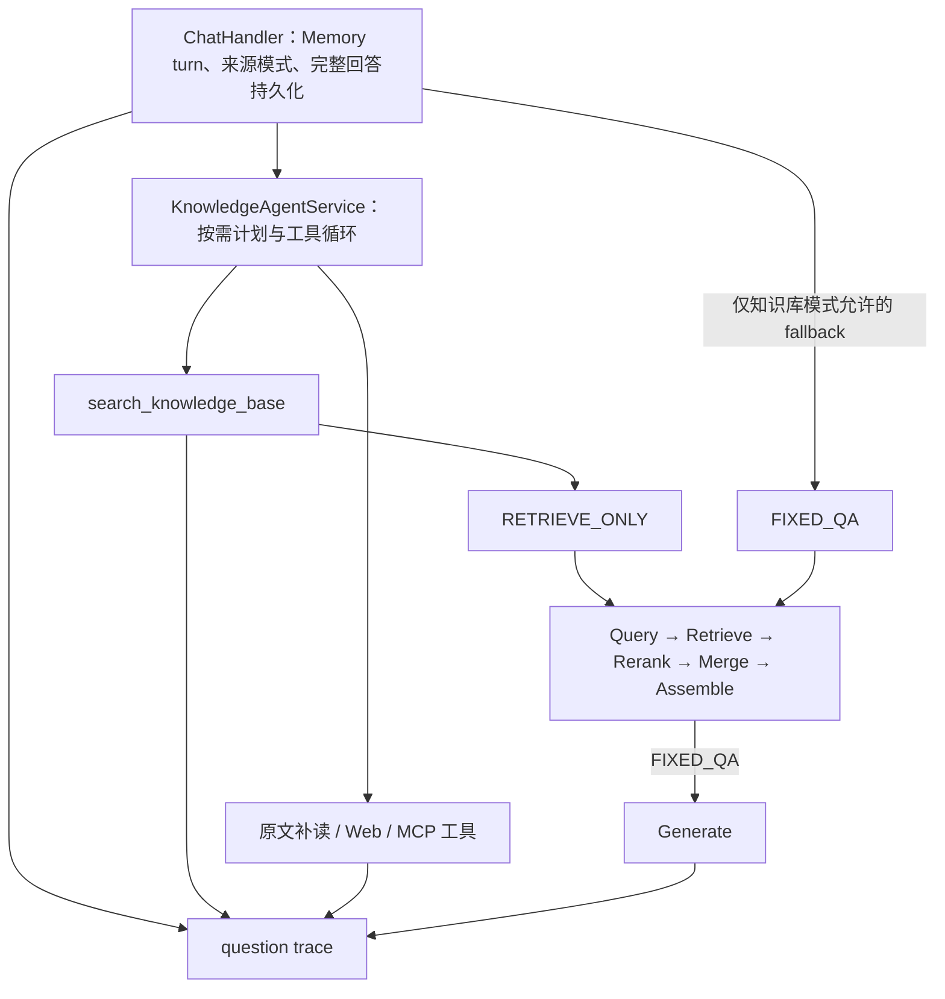

# yeRAG Agent Pipeline 与证据评测

实现工作区：`/home/zyh/projects/yeRAG-agent`，分支 `agent`。基线：`dc1dc0c270394b16b5a5e36f395649ce02ebd38b`。初版日期：2026-10-23；评测更新：2026-10-26。

## 执行路径



保留原有来源模式：AUTO/WEB 的失败不会自动换成内部知识库回答；KNOWLEDGE 可在尚未输出答案且允许 fallback 时切换固定 RAG。取消、超时、截断、权限错误不触发第二份答案。Agent 多工具调用、来源编号和统一 Memory 路径继续使用原实现。

`RagPipeline.run()` 是冷 Mono，每次订阅创建独立 `RagState`；六个阶段按 enum 顺序执行。每个状态槽只发布一次。RETRIEVE_ONLY 不执行生成。调用链使用 Reactor Context 传递服务端身份、父运行和总截止时间；fallback 继承原来的期限。

| 阶段 | 职责与证据 |
|---|---|
| Query | 复用 QueryRewriteService，记录原问题、改写问题、Prompt 版本、跳过/失败降级 |
| Retrieve | 复用 HybridRecallClient，独立记录 BM25/向量实际返回候选、原分、顺序、耗时、失败；RRF 融合保留各路分数 |
| Rerank | 复用现有 DashScope RerankClient，记录送入的截取正文、模型、前后排名、阈值与逐项决策 |
| Merge | 可选合并同一文件与上传者、已经召回的连续分块，记录来源与 UTF-16 范围；不额外读取未召回的邻居 |
| Assemble | TopK、正文预算、整份工具 JSON 字符预算，记录保留/截断/丢弃原因与实际来源范围 |
| Generate | 固定 RAG 真正等待模型流完成；空证据使用固定说明，不调用模型 |

召回身份使用 index + ES hit ID，避免不同上传者的同 MD5/块号被当成一个候选。每路均使用同一 ACL 预过滤，返回后再做权限防御检查；权限解析失败直接停止。原 `searchWithPermission` 兼容入口继续保留，Pipeline 使用同服务的详细入口，获得融合前结果以供阶段评测。

`ai.retrieval.mode=legacy` 的 Pipeline 使用带 KNN ACL 的单请求兼容召回，不执行新的外部重排。legacy 候选只有 ES 返回分数，不能用于伪造独立 BM25/KNN 分数。默认 RRF 路径与兼容路径的证据需分开比较。

## 配置

沿用现有 `ai.agent.query-rewrite-*` 与 `ai.retrieval.*`，不新增另一份 rerank URL/API Key 配置。`ai.rag.*` 控制阶段与证据：

```yaml
ai:
  rag:
    rewrite-enabled: true      # 同时受 ai.agent.query-rewrite-enabled 控制
    rerank-enabled: true       # 同时受 ai.retrieval.rerank.enabled 控制
    merge-enabled: false
    legacy-clipping: false     # true 用于对比旧 300 UTF-16 字符裁剪
    candidate-k: 0             # 0 复用 topK × recall-multiplier，上限 10000
    rerank-threshold: 0.0
    model-profile: deepseek-v4.1-flash
    tokenizer-resource: classpath:tokenizers/deepseek-v4/tokenizer.json.gz
    context-tokens: 1048576    # 已核实的当前模型容量，换模型时同步配置
    evidence-tokens: 0         # 不设置独立的小正文上限，使用剩余上下文
    safety-tokens: 4096
    compression-trigger-ratio: 0.95
    stage-timeout: 10s
    evidence-backend: local    # local | minio
    evidence-directory: /tmp/yerag-evidence
    evidence-bucket: rag-evidence
    retention-days: 7
    retention-sweep-ms: 3600000
    max-evidence-bytes: 8388608
    code-version: unknown      # 部署时填写真实构建版本
    corpus-version: unknown    # 评测时填写固定语料/索引版本
```

当前使用与实际返回的 `deepseek-flash`（DeepSeek-V4.1-Flash）匹配的官方 BPE tokenizer，模型容量为 1,048,576 tokens。来源、固定版本、SHA-256 和 MIT 许可证见 [tokenizer 说明](../src/main/resources/tokenizers/deepseek-v4/README.md)。词表压缩打包，DJL 的原生 tokenizer 库随 Maven 依赖提供，运行时不下载词表、不调用 Python。`ai.rag.tokenizer-resource` 可指向其他经过核实的本地 HF tokenizer；加载失败直接报错，不回退到按字节冒充 token。

模型输入计数覆盖解码后的消息正文、工具定义、工具参数和调用标识，并逐条预留协议开销；HTTP JSON 的二次转义和 `max_tokens` 等生成参数不计入正文 token。供应商未公开完整的 API 侧 prompt 组装，因此本地计量标为 `HF_BPE_CHAT_WITH_PROTOCOL_RESERVE:<tokenizer SHA-256>`，不宣称等同计费量；供应商返回的 `usage` 另存，缺失为 null。历史 `ESTIMATED_UTF8_BYTES_V1` 工件属于旧预算协议，不能直接作为新 token 预算的对比结果。

默认回答上限为 8,192 tokens，另留 4,096 tokens 安全空间。默认压缩阈值为 `floor((context-tokens - max-tokens - safety-tokens) × 0.95)`，即当前配置下 984,473 个本地计量输入 tokens；低于此阈值不裁剪工具正文。接近上限时显式裁剪工具正文，保留来源元数据、工具调用 ID 与配对响应，设置 `context_truncated` / `truncated` 并加入固定提示，要求答案说明证据缺口。元数据也无法容纳时显式省略旧结果，不删除协议消息。不裁剪系统规则、用户问题和工具定义；受保护内容超出模型真实可用容量时仍拒绝发送。原始工具证据保存在 tool-call 运行，model-call 的 `request` 冻结实际发送内容；`contextCompaction` 同时记录字节数、token 数、token 输入上限和受影响的工具结果数量。

当前工作区的公开覆盖配置位于 [config/application.properties](../config/application.properties)，由 Spring Boot 从项目根目录自动加载；部署环境仍可通过环境变量或命令行覆盖。现有 `.env` / `application.yml` 的跨仓库链接保持原样。换模型必须一起核实 profile、tokenizer、上下文和输出上限，不能把当前容量直接套到未知模型。

资源上限和模型 token 预算分别检查：用户问题 8 MiB，Memory / 模型请求 32 MiB，单工具结果 4,194,304 字符；网页抓取 16 MiB、正文 1,048,576 字符，MCP 响应 32 MiB。WebSocket 接收缓冲同步采用 Memory 请求资源上限，避免旧的默认小缓冲拒绝长问题。Memory 默认 `max-recent-turns=0`，按模型预算保留完整历史回合；摘要上限 60,000 字节，长期记忆召回上限 256 KiB。`evidence-tokens=0` 让检索组装使用剩余上下文；显式正数仍可配置独立正文预算。工具参数、权限、topK、调用次数和请求超时继续独立校验。

重排未配置记为 SKIPPED；调用失败/超时使用原 RRF 顺序并记 DEGRADED；成功但阈值筛空不恢复候选。仅对 `ai.retrieval.rerank.top-n` 内候选评分，尾部明确记 `OUTSIDE_RERANK_WINDOW`。正文送重排前的截取范围另有快照。

## 证据与访问

每次用户问答创建 question 运行；每次工具调用、Pipeline、模型调用有独立 UUID，parentRunId 与 question 的 child 事件关联它们，工具调用另记录 toolCallId。

每个 `runId.json` 是一份版本化 manifest，内嵌冻结事件 data 与 SHA-256；当前没有拆成多个正文对象。保存：

- question：原问题、会话/request ID、最终答案与来源、生成终态；数据库保存结果另记 `answerPersisted`。
- tool-call：工具名、声明参数、结果、来源、终态。
- pipeline：请求快照、阶段耗时、候选/排序/合并/预算决策与完整最终正文。
- model-call：请求体、请求预算、dispatch hash、响应/答案、finish reason、usage、首模型输出/首答案耗时。

追踪不保存 Authorization/API Key。证据包含问答、Memory 上下文及授权文档内容，目录位于仓库外；本地目录使用私有权限。写入原子替换，达到大小限制标为 INCOMPLETE，不能把它当作没有候选。证据写入异常不会替换原来的业务异常；完全无法保存时可能只留下旧 RUNNING 文件或没有文件，这些运行不能做确定归因。进程崩溃留下的 RUNNING 同样不可当作正常结束。

认证接口：`GET /api/v1/rag/runs/{runId}`。当前登录用户只能读取自己的 `id:数据库ID` 或 `name:用户名` 运行；无权、过期、未知 ID 均返回 404。completion 事件额外带 `runId`，原有 sources/chunk/agent_status 继续兼容。读取 question 文件的 child 列表后，可用同一接口读取各子运行。

### MinIO/MySQL

默认 local 不访问新增表。切换 minio 前：

1. 新数据库执行完整 `docs/databases/ddl.sql`；已有数据库执行 `docs/databases/migrations/20261023_rag_evidence.sql`。
2. 在现有 MinIO 创建私有 `rag-evidence` bucket；设置覆盖保留期加 2 天的对象生命周期，清理上传成功但 SQL 发布失败的孤儿对象。
3. 设置 `ai.rag.evidence-backend=minio`，继续使用部署中的 MinIO 与 MySQL 连接配置。

对象采用 `runId/sha256.json`，上传成功后才在 SQL 事务中发布 manifest、阶段和对象索引。读取验证 owner、expiry、内容 hash；按小时清理过期对象和索引。远端删除失败保留索引以便重试。SQL/MinIO 没有跨系统事务。网络/数据库超时沿用实际部署客户端配置，线上证据 I/O 会带来额外耗时，应在部署联调测量。

## 生成终态

SSE 按事件解析，保留跨网络分片的 JSON。只有有效 finish reason 或协议 `[DONE]` 能证明正常结束；无终态 EOF、错误帧、冲突结束信号会失败。length/max_tokens 记为 TRUNCATED，已有正文可以送到客户端，但不会调用 Memory 的完整回答保存路径。首 thinking 输出和首 answer 输出分别计时，不保存 thinking 正文。

终态：SUCCEEDED、DEGRADED、NO_EVIDENCE、FAILED、CANCELLED、TIMED_OUT、TRUNCATED。阶段终态和 question 终态含义不同：question 成功表示生成完整答案，不等于检索质量达标，也不等于数据库持久化成功。

## 单链路评测：事实、评审与复核分离

第一阶段每题只调用一次 `RagPipeline.run(FIXED_QA)`，不拆执行入口、不实现相邻块扩展。题集格式、50 题资料、上传/预检、真实运行和离线重算命令统一见 [评测说明](../evaluation/README.md)，设计主文档见 [第一阶段设计](superpowers/specs/2026-10-21-yerag-eval-v1-design.md)。

程序依据必要证据单元、原文 SHA-256 和 UTF-16 位置，检查候选池、重排后 Top5、合并、组装和实际请求。Hit@5 表示至少命中一个单元，Coverage@5 表示必要单元覆盖比例；NONE/PARTIAL/FULL 区分完整性，负例不计算正例指标。Top5 作为 RERANK 后的 `TOP_K` 事件冻结，保留上传者、文件、块号、独立 ES index/hit ID、原文/哈希、分数类型及名次，不新增阶段。

Judge 通过现有模型客户端的独立请求评估完整答案、遗漏、无依据与矛盾陈述，保留原始响应与模型调用工件；它不定位证据或修改 Hit/Coverage。人工复核采用追加记录，处理标注争议和判断修订；新标注版本重新预检、重新计算，旧 Judge/批准不自动沿用。

当前合成题集为待人工确认的草稿；程序会显示观测覆盖，但不把待审核或争议题填成正式零分。真实服务、身份和语料未就绪时，正式 50 题验收必须保持待验证。旧 A/B/C 与 ID 相关度并行评分入口已收敛，旧数据只做一次性模板转换。

## 验证记录

2026-10-29，当前未提交工作区的模型 BPE 预算：本次执行 `mvn test`，294 项、0 失败、0 错误、10 项按条件跳过。覆盖官方 tokenizer 指纹、禁用 tokenizer 默认 512-token 截断、转义不重复计数、工具定义/参数开销、接近 token 上限的裁剪、长问题完整落库、30 轮历史不提前摘要，以及知识库/MCP 长正文完整保留。

真实服务使用临时账号和合成会议纪要验证：244,152 字节问题通过真实 WebSocket 接收并完整保存，末尾项目编号正确返回；下一轮从完整历史正确回忆编号，没有触发上下文压缩。首轮模型请求 252,459 字节，本地计量 41,229 tokens，供应商报告 41,186 prompt tokens；后续回忆请求本地 41,318、供应商 41,212。实际返回模型为 `deepseek-flash`，请求回答预留 8,192 tokens、上下文配置 1,048,576 tokens。新会话的比较问题三个计划任务全部完成。测试账号、会话、Memory 和缓存已清理；本次样本不代表完整 1M 窗口或并发压力验收，未启用的 MySQL 并发套件不在通过范围。

2026-10-29 早期字节预算修复记录（下述 29,488 字节上限已被模型 BPE 预算替代）：当时执行 `mvn test`，285 项、0 失败、0 错误、10 项按条件跳过。`DeepSeekTransportTest` 覆盖累积工具正文、规划跨任务上下文、Memory 字节上限、完整工具定义与 JSON 转义计数、调用配对和受保护问题超限拒绝发送。真实模型使用合成资料验证 36,574 字节请求裁剪到 29,488 字节后正常完成流式回答；真实本地 HTTP/WebSocket 验证简单问题无计划、复杂比较的三个任务全部完成及完整回答保存。测试账号、会话和缓存已清理；未启用的 MySQL 并发测试不在当时通过范围。

当前实现与验收结果见 [评测说明](../evaluation/README.md#5-验证范围)。2026-10-23 的 Pipeline 初版测试记录不代表本次评测版本已通过真实服务验收。真实 MySQL / ES 测试仍由对应环境变量启用；模拟 ES、H2 或本地 HTTP 提供的测试证据不能替代真实 ES / MySQL / MinIO / 模型联调。
