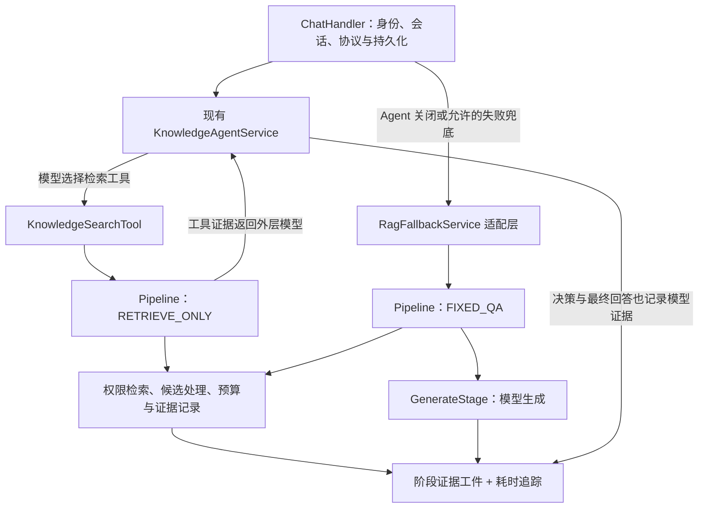

# yeRAG Pipeline 职责与评测证据实现方案

设计日期：2026-10-22（Asia/Shanghai）。本文保留最初设计基线；**2026-10-23 已在 `/home/zyh/projects/yeRAG-agent` 的 `agent` 分支实施**，使用说明、最终行为与验证范围见 [Pipeline 使用文档](../../rag-pipeline.md)。以下“当前实现”和“本次未运行”均指设计调研时点，不代表实施后的状态。

目标：把现有检索与固定 RAG 路径拆成可单独观察的阶段，让一次问答能回答“哪里丢了证据、为什么丢、模型实际看到了什么”。保留现有 Agent loop、权限来源、WebSocket 协议和会话完成规则。

## 1. 已核实基线

- yeRAG：`main`，HEAD `749a95654c756ae46ad552c5038520b52659d133`。以下判断来自本次工作区源码阅读；开始时已有前后端改动，以及未跟踪的 `docs/module-analysis/` 等文件，不推断作者，不将它们视为本方案实现。
- 技术栈：Java 17、Spring Boot 3.4.2、Reactor/WebClient、Elasticsearch Java Client 8.10.0、MySQL、Redis、MinIO。依赖版本来自 [pom.xml](../../../pom.xml)，不代表实际部署的 Elasticsearch 服务端版本。
- WeKnora：远端源码固定到 `92dfa6a1eef2be18df81c2b5fe23bc43e6f3783e`；本地 WeKnora 检出为 `aaa1accebdf673b9603aaa555c5610a8fd7727d9`。事实与文档漂移详见[研究笔记](./2026-10-22-weknora-pipeline-research.md)。
- 本次没有运行模型、ES、评测或后端测试；下文测试条目均是实施验收要求，不是已经通过的结果。

| 当前实现 | 源码证据 | 对本方案的影响 |
| --- | --- | --- |
| Agent 已能决定是否检索、执行有上限的工具循环 | [KnowledgeAgentService](../../../src/main/java/com/yizhaoqi/smartpai/agent/KnowledgeAgentService.java) | 保留外层 Agent；不再新建一个竞争的 Agent loop |
| 工具仅接受 `query`、`topK`，身份来自 `ToolExecutionContext` | [KnowledgeSearchTool](../../../src/main/java/com/yizhaoqi/smartpai/agent/tool/KnowledgeSearchTool.java)、[ToolExecutionContext](../../../src/main/java/com/yizhaoqi/smartpai/agent/tool/ToolExecutionContext.java) | Pipeline 不能让模型传入用户或 ACL |
| 混合检索在一个 ES 请求里设置顶层 KNN、query 和 BM25 rescore | [HybridSearchService](../../../src/main/java/com/yizhaoqi/smartpai/service/HybridSearchService.java) 的 `searchWithPermission()` | 目前拿不到独立向量/BM25 候选列表；先记录现有整体返回，不能伪造两路分数 |
| Embedding 失败会退到文本检索；混合和后备都失败时可能返回空列表 | 同上，`searchWithPermission()`、`textOnlySearchWithPermission()` | 必须区分降级、正常空召回和基础设施失败 |
| 工具和固定 RAG 都将单条正文裁到 300 字符；工具另有总字符预算 | [KnowledgeSearchTool.serialize()](../../../src/main/java/com/yizhaoqi/smartpai/agent/tool/KnowledgeSearchTool.java)、[RagFallbackService.stream()](../../../src/main/java/com/yizhaoqi/smartpai/service/RagFallbackService.java) | 裁剪本身也是证据变化，必须记录原长、保留范围、原因 |
| 固定 RAG 同步检索后通过 callback + Disposable 启动生成 | [RagFallbackService](../../../src/main/java/com/yizhaoqi/smartpai/service/RagFallbackService.java) | 可作为第一个接入点；需要可等待真实生成完成的阶段返回值 |
| Agent 的 `streamFinal()` 仅返回字符串；解析会丢弃 `[DONE]`，未对外暴露 finish reason/usage | [AgentLlmClient](../../../src/main/java/com/yizhaoqi/smartpai/agent/AgentLlmClient.java)、[DeepSeekClient](../../../src/main/java/com/yizhaoqi/smartpai/client/DeepSeekClient.java) | 生成证据需要补充带终态信息的类型化输出 |
| 已有取消、fallback、完整回答持久化与 memory 路径 | [ChatHandler](../../../src/main/java/com/yizhaoqi/smartpai/service/ChatHandler.java)、[AGENTS.md](../../../AGENTS.md) | 入口只负责协议和持久化；流水线不能重复保存消息 |

**评测现状限制**：本次在 `docs/`、`src/main/`、`src/test/` 中搜索评测、rerank、benchmark 等入口，未找到专门的知识问答评测执行器或独立模型重排模块。现有 ES BM25 rescore 不等于外部语义 reranker。用户提及的评测工作可能位于其他位置，接入点按待确认处理，不声称已经接通。

### 1.1 改造前先核验检索权限语义

当前 ACL 在顶层 `query.bool.filter`，顶层 `knn` 未设置相同 filter。Elastic 8.10 官方文档说明：顶层 `knn` 与 `query` 结果按 OR 合并；KNN 的过滤应设置在 `knn.filter`。因此，按该版本语义，现有写法不能证明向量候选受同一 ACL 限制；注释“必须命中关键词”也不能作为执行语义证据。[官方 kNN 与混合检索说明](https://www.elastic.co/guide/en/elasticsearch/reference/8.10/knn-search.html#_combine_approximate_knn_with_other_features)、[官方 filtered kNN](https://www.elastic.co/guide/en/elasticsearch/reference/8.10/knn-search.html#_filtered_knn_search)

这是静态源码与官方语义指出的风险，**本次没有在真实部署复现越权**。实施前确认实际 ES 版本及请求兼容性，尤其顶层 KNN 与 rescore 的组合；使用不可访问但向量高度相似的文档做集成验证。方案继续复用并修正 `searchWithPermission`，不改用无权限的兼容搜索方法；新增各路检索必须复用同一份服务端构造的 ACL，无法确定身份或权限时停止，不把它当可降级的检索故障。

## 2. 从 WeKnora 借鉴什么

以下是设计选择；来源事实见[研究笔记](./2026-10-22-weknora-pipeline-research.md)。

1. 将请求配置、中间结果和运行时句柄分开。不同阶段保存自己的输出，不反复覆盖同一个 `results`。
2. 明确阶段列表的顺序；并发发生在召回阶段内部，分支返回独立结果，由父阶段归并。
3. 显式记录降级和无证据结果；取消优先于“无结果”的兜底。
4. 阶段追踪覆盖真实生命周期。当前 WeKnora 已跳过异步生成的阶段 span，由模型 generation 覆盖流生命周期；不能沿用旧文档的“阶段 span 提早关闭”作为当前实现事实。
5. 阶段 span 解决耗时定位；完整候选与上下文工件解决评测归因。WeKnora 的有限预览与诊断值得参考，但不直接满足全量证据要求。

首版不移植 WeKnora 的 EventManager、同事件 `next()` 责任链、分布式 StreamManager 或图谱/Wiki/数据分析。先用有序阶段列表表达当前确实存在的流程。

## 3. 总体接入方式



- `RETRIEVE_ONLY`：查询处理 → 召回 → 可选重排 → 可选合并 → 工具上下文组装。返回材料，**不在工具里调用生成模型作答**。
- `FIXED_QA`：上述阶段 → 生成。先由现有 `RagFallbackService` 适配已有 callback/Disposable 接口，后续可简化。
- 普通 Agent 可能不检索，也可能多次检索。一个用户问题使用一个 `questionRunId`，每次工具调用使用独立 `pipelineRunId/toolCallId`，不可把多轮候选混在一起。
- Agent 最终回答可能直接来自 `decide()`，也可能来自 `streamFinal()`。两条路径都在模型客户端记录实际请求和输出；不能只给 fallback 的 GenerateStage 埋点。

## 4. 阶段职责、输入、输出与证据

| 阶段 | 读取 | 产出 | 至少保留的证据 | 初始策略 |
| --- | --- | --- | --- | --- |
| QueryStage | 原问题、允许使用的会话上下文、改写配置 | `QueryResult`：原问题、检索问题、改写状态 | 改写前后文本、Prompt/模型版本、失败或跳过原因、耗时 | 默认保留原问题；改写按开关接入 |
| RetrieveStage | 检索问题、服务端权限范围、每路候选预算 | `RetrievalResult`：各路结果、融合候选、降级情况 | 每路 query、状态、候选标识/原分/名次/耗时、查询配置、融合映射 | 第一阶段包装现有检索；后续拆独立向量与 BM25 |
| RerankStage | 融合候选、查询、重排策略 | `RerankResult`：重排顺序与逐项选择决策 | 输入顺序、模型分、输出顺序、阈值、丢弃原因、降级原因 | 未配置时 `SKIPPED`，不能记为成功调用了模型 |
| MergeStage | 选中候选、当前可授权读取的相邻正文 | `MergeResult`：正文片段与来源映射 | 合并/去重关系、父子来源、扩展前后长度、规则版本 | 无可靠相邻块能力时透传并记跳过，不凭序号跨文档拼接 |
| AssembleStage | 合并结果、模板、历史、工具定义或固定 QA 预算 | `ContextResult`：实际保留正文、来源、预算决策、固定 QA 消息草稿或工具 observation | 每条保留/删除/截取原因，原文到输出范围映射、Token 统计、实际输出工件 | 明确替代当前散落的 300 字符裁剪；先可记录旧行为，再单独变更预算 |
| GenerateStage | 固定 QA 的消息、模型配置、输出端 | `GenerationResult`：回答、usage、终态 | 实际入模请求、模型标识、首答案耗时、总耗时、finish reason、usage、输出与引用 | 只有真实流结束、失败或取消后才结束阶段 |

两条规则：

- 每阶段只能写自己的输出槽位；下游读取已完成结果。`retrieval`、`rerank`、`merge`、`context` 必须同时保留，不能覆盖掉上游证据。
- 空集合必须带状态。`RerankResult = EMPTY_AFTER_FILTER` 不能被合并阶段误当“没有运行重排”而自动回退原始候选；是否保留 top1 或退回召回顺序必须是显式策略并有证据。

## 5. Java/Reactor 接口草图

用户提出的 `void execute(RagContext)` 适合描述职责，但 yeRAG 已用 Reactor 执行模型流。建议返回可等待完成的 `Mono<StageOutcome>`，避免方法返回时阶段仍在后台生成。以下为接口草图，辅助类型待实施，不是本次可编译补丁。

```java
public interface RagStage {
    StageKey key();
    Mono<StageOutcome> execute(RagContext context);
}

public interface RagPipeline {
    Mono<RagResult> run(RagRequest request, RagObserver observer);
}

public record RagRequest(
        String questionRunId,
        String pipelineRunId,
        String originalQuestion,
        AuthenticatedScope scope,
        List<AgentMessage> history,
        PipelineMode mode,
        RagOptions options) {}

public record RagContext(
        RagRequest request,
        RagState state,
        RagRuntime runtime) {}

public record StageOutcome(StageStatus status, String reasonCode) {}
```

具体约定：

- `RagRequest` 与其中嵌套对象做不可变快照，集合防御性复制；`originalQuestion` 不被改写覆盖。身份来自认证入口，模型只能影响受验证的 query/topK。
- `RagState` 是每次订阅独立的内部状态，按阶段提供类型化槽位和一次发布的方法；避免 `Map<String,Object>`、Lombok 全字段任意 setter。输出中的列表和候选也是不可变值。
- `RagRuntime` 持有父级 trace、截止时间、取消句柄、证据写入器和 `RagObserver`。不把运行时句柄序列化进证据，不在请求快照写密钥。
- `RagObserver` 只转发阶段进度、正文增量和引用，映射到现有 WebSocket 事件。它不决定阶段顺序，不保存业务会话。
- 阶段返回冷执行对象，订阅时才执行。Pipeline 在订阅时创建 Context，顺序订阅各阶段；内部只在确定的并发分支使用并行，拒绝共享可变候选列表。
- 阶段正常结果为 `SUCCEEDED / SKIPPED / DEGRADED / SHORT_CIRCUITED`；失败走异常；取消与超时由执行器归一为终态，不能伪造正常 `StageOutcome`。
- `GenerateStage` 不在内部自行 `subscribe()` 后立即返回。它把模型流组合进返回值，直到终态才完成；原有 callback 入口仅在最外层做一次订阅和 Disposable 适配。
- 当前 ES/Embedding 为阻塞调用，通过 `boundedElastic` 包装。同步 `AgentTool.execute()` 的过渡适配仅允许在现有工具工作线程中等待、受剩余期限限制；后续统一增加异步工具执行入口，移除适配层等待。不得在 WebClient 事件线程阻塞。

建议将这些类型放入现有包下的 `com.yizhaoqi.smartpai.rag`；沿用 `agent`、`service`、`client` 现有模块职责，不更换 Java 包名。

## 6. 检索与重排的渐进改造

### 6.1 先让现有检索返回可解释结果

保留旧的 `searchWithPermission(query,userId,topK)` 供兼容调用；为 Pipeline 增加带类型结果的入口，例如 `searchWithPermissionDetailed(...)`，由同一内部实现执行查询。

`RetrievalResult` 至少含：`mode`（现有混合或文本降级）、`status`、`candidates`、`elapsedMs`、`degradedReason`、`errorCode`。现有方法遇到 ES/Embedding 故障不能继续只用空列表表达；兼容入口可按旧约定转换，Pipeline 入口必须保留错误。

第一阶段标为 `LEGACY_ES_HYBRID`，只报告 ES 真正返回的 `_score` 与最终列表。KNN/BM25 独立排名、内部 rescore 淘汰集合在当前响应中不可见，应记录 `UNAVAILABLE_LEGACY_QUERY`，不能由最终 `_score` 反推出两路分数。

### 6.2 需要逐路评测时再拆召回

拆成独立向量召回与 BM25 召回，每一路都使用服务端生成的相同权限过滤。记录各路完整返回池后再融合；候选深度受配置限制，所谓“完整”只指本次实际返回的池，不指扫描了全索引。

- 各路返回 `RouteResult(status,candidates,error,elapsed)`，父阶段集中合并。
- 向量分与 BM25 原始分尺度不同，首版使用基于名次的 RRF；常数、权重和候选深度通过评测确定，不声称直接复制 WeKnora 参数即最优。
- 去重以索引标识 + ES 文档 ID 为主，保存同一 chunk 的多路来源与分数。当前 `SearchResult` 未带 ES hit ID，需从响应补上；`fileMd5 + chunkId` 仅作业务定位补充，不能未经核验就当跨用户、跨索引的全局唯一标识。
- 一路失败、另一路成功：按显式策略标 `DEGRADED`。所有可用路正常返回但均空：`NO_EVIDENCE`。所有路故障：`FAILED`，不能算作 Recall=0。

### 6.3 重排模型作为可替换 Adapter

新增小接口 `Reranker.rerank(query,candidates)`，由具体模型客户端实现。测试用固定分数 Adapter，线上 Adapter 在配置可用后接入。首版关闭时保留召回顺序；打开时保留每个候选的原分、模型分、原排名、新排名和选择原因。

模型调用失败可按配置回退融合顺序并记 `DEGRADED`；模型成功但阈值筛空是另一种结果，按无证据策略处理。不要把 WeKnora 的阈值、复合权重、FAQ/Wiki 加权或 MMR 全部一次搬入；先做开关消融，再决定保留哪些规则。

## 7. 上下文预算与可追溯裁剪

当前 300 字符裁剪不能说明完整模型请求是否超预算，也可能删掉决定答案的例外条款。先记录旧裁剪，再切换为有依据的预算策略。

```text
可分配证据预算 = 模型上下文上限
                 - 系统消息与工具定义
                 - 当前问题与选定历史/记忆
                 - 预留输出 Token
                 - 安全余量
```

按目标模型 tokenizer 计算；没有匹配 tokenizer 时记录 `tokenCountKind=ESTIMATED`、估算算法与版本，使用保守限制，不宣称精确。供应商 usage 是事后统计，不能替代请求前预算。

- 优先按完整片段选择，记录 `TOP_K / DUPLICATE / BELOW_THRESHOLD / TOKEN_BUDGET` 等删除原因。
- 超长单片段可截取与命中相关的窗口，保存 `sourceHash`、原始长度、窗口起止、保留正文、原/保留 Token 数。起止坐标必须声明是规范化后正文的 UTF-16 下标或其他明确单位，不能与 PDF 页坐标混用。
- 合并或邻居扩展后的片段保存多个 `sourceChunkId` 与输出范围映射。扩展、合并后重新计数，不只给召回前的短块计数。
- `RETRIEVE_ONLY` 的组装结果只是工具 observation。外层 Agent 后续还会追加历史、其他工具结果，因此必须在 `DeepSeekClient` 真正发送前再次校验完整请求并保存**最终 wire messages**。
- 引用只关联实际入模的正文；被预算移除的片段不能仅因早先召回过就列为回答证据。候选存在、上下文存在、答案实际引用是三类不同事实。

**截断恢复**：本方案不依赖模型自动猜测“应该补读”。评测可从工件查看被删正文；若要在线补读，需单独设计带授权校验的文档窗口读取能力和 cursor/offset 协议，不把它伪装成当前已经存在的工具。本期优先保证裁剪可见、原文版本可定位、最终证据可审计。

## 8. 证据数据结构与保存方式

### 8.1 用一份运行清单连接阶段工件

每个 `QuestionRun` 记录 `questionRunId`、服务端用户标识、会话/turn/request ID、代码版本、实际配置 hash、Prompt 版本、模型标识、索引/语料版本、起止时间、终态、`evidenceStatus`。无 memory 时生成请求 ID，不把 socket ID 当稳定用户身份。

`StageRun` 记录 `pipelineRunId + stage + attempt`、父模型/工具调用 ID、开始/结束时间、输入/输出工件引用、状态、错误或降级原因。耗时用单调时钟计算，墙上时间用于展示和跨记录关联。

| 工件 | 必要字段 |
| --- | --- |
| `query.json` | 原问题、检索问题、使用的历史引用、改写模型/Prompt、状态 |
| `retrieval.json` | 各路 query/参数/状态/耗时、候选 ID/原分/原名次、融合前后映射 |
| `rerank.json` | 全部输入候选、打分状态、模型分、前后排名、逐项保留/过滤原因、是否降级 |
| `merge.json` | 输入 ID、合并后 ID、来源范围、内容 hash、去重/扩展决策 |
| `context.json` | 最终选中正文和来源、每片段预算、删除/截取明细、Token 计算方式、引用映射 |
| `model-call.json` | 实际发送的 messages/模型参数、输出工件引用、usage、finish reason、耗时与终态 |

正文可作为按内容 hash 寻址的独立工件，多个阶段用引用关联，避免在每份 JSON 重复保存。只保留 hash 不足以还原模型看到的内容：评测运行必须同时有可读取的冻结正文，或可读取的固定版本内容存储。

### 8.2 先做开发评测保存，再接在线持久化

开发评测先写到**显式配置的仓库外目录**，每次运行一份 manifest 和工件文件；默认不往 Git 工作区写真实问答数据。manifest 含 `schemaVersion` 和工件 hash，写完工件后再原子提交清单，未完成的运行标为不完整。

在线阶段复用已有 MinIO 保存工件，MySQL 保存运行/阶段索引；若采用此存储方案，实施时同时修改 `docs/databases/ddl.sql` 与 `database-design.md`，新增 `rag_run`、`rag_stage_run` 和工件索引结构，不能只靠 JPA 自动建表。追踪平台仅接收摘要和工件关联 ID，完整评测工件不依赖 trace 采样是否命中。

查询运行证据要按同一认证用户/会话授权；文件中不写 API Key、Authorization 等凭据。在线证据有大小和保留期限配置；如果采样或裁剪了证据，必须标出范围。

证据写入失败时，不用追踪异常覆盖原始业务异常；运行标 `evidenceStatus=INCOMPLETE`。本地评测需要完整证据才能做阶段归因，不把缺失工件解释为没有候选。是否允许在线问答在工件不可用时继续，由显式策略决定。

## 9. 生成完成、超时与取消

新增类型化模型流，例如 `GenerationEvent` 表达答案增量、usage、finish reason 与协议终态；保留现有 `streamFinal()` 为兼容适配，新增详细流方法，不立即破坏现有调用者和测试。

- 分开记录 `firstModelOutputMs`（若可见）、`firstAnswerMs`、`totalModelMs`、`totalQuestionMs`。思考输出不算首个可见答案。
- GenerateStage 的 Mono 直到流成功结束、失败、超时或取消才结束；所有终态都关闭追踪一次。模型成功结束还不等于会话已成功保存，持久化结果另外记录。
- EOF 不能自动证明完整回答：按供应商协议记录结束信号。`length/max_tokens` 等输出截断、无结束信号的断流、HTTP/SSE 错误要有独立状态，不能一律写 `SUCCEEDED`。供应商不返回 usage 时存 null 和缺失原因，不写 0。
- 问答终态建议：`SUCCEEDED / NO_EVIDENCE / FAILED / CANCELLED / TIMED_OUT / TRUNCATED`。阶段终态与问答终态分别存；`TRUNCATED` 可以发送已有正文并明确告知未完整，不调用 memory 的完整回答持久化路径。
- 空召回策略默认明确告知知识库无证据；若允许模型做通用回答，记录 `answerMode=GENERAL_FALLBACK`，不能当有知识库支撑的成功回答评测。
- 请求总截止时间贯穿 Agent、工具、Pipeline 与 fallback。重排超时后回退召回顺序不能重置总时间；Agent 失败进入 fallback 也不能重新获得一整份总预算。
- 取消优先于空结果与降级：已取消就停止，不额外发起 fallback 或模型生成。Reactor 取消继续传到 HTTP、并发召回与证据收尾；阻塞 ES 客户端还要配置自身超时，不能假设取消订阅一定立即中断底层查询。
- 保留现有“已经输出答案后不再启动 fallback”规则，避免两份答案混流。WebSocket 的 `agent_status/chunk/completion` 继续兼容；请求/会话归属由 ChatHandler 固定，迟到事件不能写到当前切换后的会话。

## 10. 如何接入评测并定位损失

评测样本至少有 `caseId`、问题、服务端测试身份/权限范围、语料版本、相关文档/分块或相关证据区间、期望事实。模型、Prompt、检索参数、索引版本与运行 ID 一起冻结。暂未发现现有 runner，因此先提供 JSONL 导入/导出契约，之后对接用户实际评测入口。

| 评测位置 | 指标/检查 | 解释边界 |
| --- | --- | --- |
| 每路召回与融合后 | Recall@K、Hit@K；固定相关标注集合 | 记录 K 的含义、文档/分块粒度；全部路故障不计作普通检索未命中 |
| 重排后 | MRR/nDCG、相关证据保留率、逐项淘汰原因 | 没有相关度标注时不能假装计算真实 nDCG；对比相同候选池 |
| 合并与上下文后 | 相关证据区间覆盖率、预算淘汰率、来源可追溯率 | 只看 chunk ID 不够：ID 保留但答案所在文字被裁掉也算证据损失 |
| 生成后 | 正确性、证据支持度、引用正确性、首答案/总耗时、成本（有 usage 时） | 自动评审保留评审模型/Prompt/原始判断；不是人工真值 |

归因按“最早丢失必要证据的位置”给出可解释诊断，可同时打多个标签，不声称自动确定唯一因果：

```text
检索问题偏离原意？                         → QUERY_DRIFT
必要证据没进入任何实际返回候选池？           → RETRIEVAL_MISS
召回有，重排后没有？                       → RERANK_DROP
重排有，但合并/去重关系无法保留必要内容？     → MERGE_LOSS
内容进入候选，但因预算/截取没进入最终请求？   → CONTEXT_LOSS
最终请求含足够证据，答案仍错误？             → GENERATION_ERROR（待人工或评审确认）
候选、请求或输出工件缺失？                 → EVIDENCE_INCOMPLETE
```

“证据在最终上下文中”仍不保证答案一定可推导；冲突、过期、歧义与标注错误另行记录。阶段诊断是排查线索，需消融或人工复核确认因果。

先做单变量实验：原问题 vs 改写、现有混合 vs 独立两路融合、rerank 开/关、旧 300 字符裁剪 vs 预算组装。使用同一冻结样本与语料，报告质量、耗时和降级率，不同时改所有参数后归因。

重放分两类：读取冻结工件可重现“当时选了什么、发了什么”；重新调用检索/模型是新的实验，必须分配新运行 ID。即使 temperature=0，也不承诺模型逐字重现旧答案。

## 11. 原设计的分批任务与文件落点（历史清单）

### P0：先把当前链路看清楚

- [ ] 新建 `rag/model` 中的请求、阶段结果、终态和证据类型；新建 `rag/trace` 的工件写入器与运行清单。
- [ ] 为 `HybridSearchService` 增加详细结果入口，保留现有兼容方法；区分 embedding 降级、ES 失败、真实空列表；先核验并修正 KNN 权限过滤。
- [ ] 在 `KnowledgeSearchTool`、`RagFallbackService`、`DeepSeekClient` 记录实际候选、现有裁剪、实际模型请求与输出。改写/模型重排未启用时明确标跳过。
- [ ] 关联外层 Agent 模型调用、每次工具调用与 fallback，保留当前业务行为；权限修复和诊断差异单独记录，不能声称所有行为完全不变。
- [ ] 加一份固定样本的本地证据导出；可以从问题一路找到真实入模文本，并区分“ES 故障”和“确实没有资料”。

**P0 验收**：不依赖新增模型即可定位现有 300 字符裁剪；权限与错误语义有验证；每次实际模型调用有父问题关联。P0 记录现状，不把不存在的独立检索路/重排分数写成证据。

### P1：固定 RAG 接入可等待的 Pipeline

- [ ] 新建 `rag/RagPipeline.java`、执行器、`RagStage.java` 与六个阶段；默认 Query 透传、Rerank/Merge 跳过。
- [ ] `RagFallbackService` 改为调用 `FIXED_QA`，保留外部 callback/Disposable 契约；`ChatHandler` 保持协议与持久化职责。
- [ ] `DeepSeekClient` 增加类型化生成事件，提供 finish reason、usage、真实终态；生成追踪与真实流生命周期一致。
- [ ] 先按开关替换 fallback 的 300 字符裁剪，落实最终请求预算与来源范围映射；把预期行为变化写入测试。

**P1 验收**：成功、空证据、部分输出后错误、超时、取消、输出截断都能明确区分；一次请求只有一次终态，失败或取消不保存成完整回答。

### P2：共享检索阶段，再增加算法能力

- [ ] `KnowledgeSearchTool` 接入 `RETRIEVE_ONLY`，保留 query/topK 严格校验与服务端身份注入；处理同步工具向异步执行的过渡。
- [ ] 两条入口复用同一候选处理和裁剪证据逻辑；工具结果仍只提供材料，不在工具里嵌套生成答案。
- [ ] 拆独立向量/BM25，记录原始候选池并增加 RRF；为每一路加相同权限集成测试。
- [ ] 分别增加可开关改写与 Reranker Adapter；有当前分块元数据支撑时再实现 Merge 的相邻扩展。

**P2 验收**：同一候选池可对比重排前后；每路失败有状态；任何失败降级都不放宽权限；去重与合并后仍能回溯原始证据。

### P3：评测闭环与在线证据索引

- [ ] 新建 `src/test/resources/rag-eval/` 的小型冻结样本及测试 Adapter；真实评测数据放显式配置目录，不默认提交真实企业内容。
- [ ] 新建评测导入/导出及阶段归因 runner，产出逐题 JSONL 和聚合报告；与用户实际评测入口确认对接。
- [ ] 按部署需要将工件接 MinIO、索引接 MySQL，同时更新两份数据库文档；追踪摘要再接现有可用遥测平台。
- [ ] 先比较质量与延迟，再决定默认开启改写、重排、合并以及各预算值。

**P3 验收**：一条失败样本能展示召回、重排、上下文和最终模型请求的证据变化；缺证据的运行单独统计，不输出虚假的确定归因。

## 12. 验证计划与本次交付范围

实施时新增有意义的模块验收测试：

1. 阶段顺序与结果槽位：下游读取对应结果；并行分支不覆盖彼此结果；禁用阶段显示跳过。
2. 权限：不可访问但高相似的向量结果不能进入候选、工具结果、上下文或证据查看接口；包含跨用户、组织和公开文档案例。ES 查询语义用匹配版本集成环境验证，mock 只能验证构造参数。
3. 失败与降级：embedding 失败、单路失败、所有路失败、真实空召回、rerank 超时和成功筛空分别有明确结果。
4. 预算与来源：超长单块、边界 Token、合并去重、窗口裁剪、最终 Agent wire messages 超预算都可追溯；裁掉关键例外条款的样本应被归为上下文损失。
5. 生成生命周期：多段答案、finish reason、usage 缺失、输出长度截断、无终态断流、超时、取消、重复终态；阶段/问题只收尾一次。
6. 集成：Agent 多次检索、直接回答、达到工具上限后最终流式回答、Agent 失败进入 fallback、memory 开/关、会话切换后的迟到事件；WebSocket 兼容且完整回答规则不退化。
7. 证据：工件完整性校验、快照不可变、采样/缺失标记、错误写入不覆盖业务原因、相同运行关联与重放。

先跑相关现有测试，再加本方案阶段/评测测试；后端实现完成后按仓库约定执行 `mvn test`：

```bash
mvn -Dtest=KnowledgeSearchToolTest,KnowledgeAgentServiceTest,ChatHandlerAgentTest,DeepSeekClientTest test
mvn -Dtest='Memory*Test' test
mvn test
```

这些命令是未来实施验证计划，本次没有执行。已确认仓库存在上述核心测试代码；本次没有发现单独的 `RagFallbackServiceTest`，旧计划写过该名称不代表文件存在。真实 ES、模型、MinIO 和 MySQL 行为须另做部署验证，不能由 mock/H2 测试代替。

本次只新增本方案及同目录研究笔记。未修改业务代码、数据库结构、AGENTS.md 或已有学习/模块分析文档；未读取 `.env`，未提交或推送。

### 待实施前确认

- 实际 ES 服务端版本、现有 KNN/rescore 请求是否正常执行，以及权限过滤的真实行为。
- 评测集和 runner 的实际位置、标注粒度与允许使用的测试身份。
- 改写/重排模型及预算、生成模型 tokenizer 和供应商结束信号契约。
- 原始证据的保存范围、工件存储位置和在线数据保留策略。

优先落地 P0；它已经能回答“当前系统到底传了什么给模型”，也为后续每一次算法改动提供可比较的基线。


## 2026-10-23 实施记录

- 工作区：`/home/zyh/projects/yeRAG-agent`，分支 `agent`，基线 HEAD `dc1dc0c270394b16b5a5e36f395649ce02ebd38b`。实现尚未提交。后续不再向 main 工作区写入本任务实现。
- 已实现六阶段、两种模式、工具/fallback 共用、每次订阅隔离、权限召回适配、模型请求/生成终态、关联工具调用和 question、原始文本来源与裁剪记录、local 和 MinIO/MySQL 证据存储、授权查询与保留清理、冻结 JSONL 评测和显式在线实验入口。
- 复用 agent 分支已有 QueryRewriteService、HybridRecallClient、RRF 配置和 DashScope RerankClient；保留多工具、Web/MCP、来源模式、原文补读与统一 Memory。合并仅处理已授权召回的相邻分块，未在 Merge 阶段额外抓取邻居。预算计数为 UTF-8 字节估计。
- 真实企业评测集、外部评审服务与遥测平台未自动接入；这类部署和数据依赖不由合成样例证明。真实 ES ACL 集成用例、MySQL 并发用例需显式环境才能运行。
- 最终验证命令与结果见使用文档的实施验证记录。
